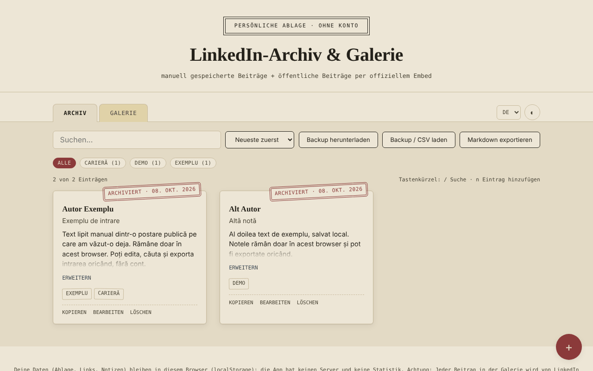

# LinkedIn-Archiv & -Galerie — gespeicherte Momente, ohne Konto

[English](README.md) · [Română](README.ro.md) · [Français](README.fr.md) · [Italiano](README.it.md) · [Español](README.es.md) · [Português](README.pt.md) · **Deutsch** · [Magyar](README.hu.md)

**Version:** 1.2.0 · **Zuletzt aktualisiert:** 2026-10-19

Oberflächensprachen: **Română, English, Français, Italiano, Español, Português (PT), Deutsch, Magyar**

Eine einzige HTML-Datei, in der du lokal Notizen zu LinkedIn-Beiträgen (manuell kopiert) und eine Galerie öffentlicher Beiträge aufbewahrst, die über das offizielle LinkedIn-Embed angezeigt werden.

**Online-App:** https://chiuta.github.io/Arhiva-LinkedIn/

*(Der Screenshot enthält Beispieleinträge, die zu Demonstrationszwecken eingefügt wurden.)*

## Was es ist

Zwei Tabs: **Archiv** (Text, Autor, Link, Tags, von dir aus bereits gesehenen Beiträgen eingefügt) und **Galerie** (der Link eines öffentlichen LinkedIn-Beitrags oder der Code „Embed this post“, angezeigt in einem offiziellen LinkedIn-Iframe). Die App verbindet sich nicht mit LinkedIn, extrahiert keine Inhalte (Scraping) und nutzt nicht die LinkedIn-API: Alles, was im Archiv erscheint, hast du selbst eingefügt, und die Galerie lädt lediglich das Embed, das LinkedIn öffentlich anbietet. Inoffiziell, nicht mit LinkedIn verbunden.

## Funktionen

Im Code verifiziert:
- Einträge hinzufügen / bearbeiten / löschen (mit Bestätigung), in beiden Tabs; Tags, Filtern nach Tag, Suche (unabhängig von Diakritika und Groß-/Kleinschreibung), Sortierung nach Datum.
- Galerie: akzeptiert den Iframe-Code „Embed this post“, eine URN `urn:li:activity|share:…` oder einen Beitragslink mit `-activity-<Nummer>-`; baut die Adresse `https://www.linkedin.com/embed/feed/update/...` auf; Adressen anderer Domains werden abgelehnt.
- Zähler „N von M Einträgen“, Anzahl der Einträge pro Tag, Sortierung auch nach Autor (A–Z).
- Markdown-Export der gefilterten Liste des aktiven Tabs; Schaltfläche „Kopieren“ bei den Archiv-Einträgen (Text, Titel, Link).
- Warnung beim Speichern eines bereits vorhandenen Links (mit einem zweiten Druck kann trotzdem gespeichert werden).
- Tastenkürzel: `/` für die Suche, `n` für einen neuen Eintrag (wenn der Fokus nicht in einem Textfeld liegt).
- Druckstil: Es werden nur die Karten des Archivs gedruckt, ohne Werkzeugleiste.
- CSV-Import ins Archiv (Schaltfläche „Backup / CSV laden“): Die Textspalte ist Pflicht (`content`, `text`, `commentary` oder `ShareCommentary`); optional `url`/`link`/`ShareLink`, `author`, `title`, `date`, `tags`; Trennzeichen `,` oder `;`, Felder in Anführungszeichen; Duplikate (gleicher Link und gleicher Text) und Zeilen ohne Text werden übersprungen, und Nicht-http(s)-Links werden ignoriert. Nützlich, um Notizen aus einer eigenen Tabelle oder einem CSV-Export gesammelt zu übernehmen.
- JSON-Backup (Download/Upload); beim Import werden die Einträge validiert und solche mit bereits vorhandener `id` ignoriert.
- Helles/dunkles Design, 8 Sprachen (RO, EN, FR, IT, ES, PT, DE, HU).

## Anleitung

1. Drücke im **Archiv** auf „+“, füge den Beitragstext ein (Pflicht), optional Link, Autor, Titel, Datum und Tags, und dann „Speichern“.
2. Drücke in der **Galerie** auf „+“ und füge den Link des öffentlichen Beitrags oder den Code aus „Embed this post“ ein (auf LinkedIn: die Schaltfläche „…“ → „Embed this post“).
3. Nutze Suche, Tags und Sortierung, um Einträge zu finden.
4. „Backup herunterladen“ speichert alles in einer JSON-Datei; „Backup laden“ stellt es in einem anderen Browser wieder her.

## Datenschutz und Netzwerk

- Speicherung: `localStorage` (Schlüssel `lka_archive_v1`, `lka_gallery_v1`, `lka_theme_v1`, `lka_lang_v1`). Die Daten bleiben in deinem Browser; es gibt keinen eigenen Server und keine Statistiken. Ist der Speicher blockiert (privater Modus), zeigt die App beim Speichern eine Meldung an.
- Externer Host: `www.linkedin.com`, **nur** im Tab Galerie, eine Anfrage pro angezeigtem Beitrag. „Ohne Konto“ bedeutet nicht „ohne Tracking“: LinkedIn erhält deine IP-Adresse und die Adresse des angezeigten Beitrags, kann innerhalb dieses Frames eigene Cookies setzen und dich, wenn du im selben Browser bei LinkedIn angemeldet bist, wiedererkennen. Wenn du das nicht möchtest, nutze nur den Tab Archiv.
- „Original öffnen“-Links öffnen sich nur per Klick, mit `noopener`; es werden nur `http(s)`-Links akzeptiert.
- Browser-Berechtigungen: Es fordert keine an.

## Grenzen und Hinweise

- Beiträge im Archiv können Texte und personenbezogene Daten anderer Personen enthalten und sind urheberrechtlich geschützt; bewahre sie für den persönlichen Gebrauch auf und beachte die LinkedIn-Nutzungsbedingungen und das Datenschutzrecht, bevor du sie erneut veröffentlichst.
- Die Galerie zeigt nur, was LinkedIn einbetten lässt; gelöschte oder private Beiträge werden nicht angezeigt.
- Die Vorschau der Embeds konnte in diesem Repository nicht mit einem echten Netzwerk getestet werden; die Tests verwendeten einen lokalen Ersatz für den LinkedIn-Frame.
- Die Sandbox des Frames (`allow-scripts allow-same-origin allow-popups…`) ist eine Vorsichtsmaßnahme; wenn ein Embed nicht korrekt angezeigt wird, ist dies die erste Prüfung.

## Lokal / offline ausführen

Lade `index.html` herunter und öffne sie in einem Browser. Der Tab Archiv funktioniert vollständig offline; die Galerie benötigt Internet.

## Verlauf / Changelog

### 1.1.0 — 2026-10-14
- Datensicherung und Datenkennzeichnung (fff-kit).

### 12. Oktober 2026 (v1.0.0)
- 1.0.0 — 2026-10-12: Die Version und das Datum der letzten Aktualisierung werden in der App angezeigt

### 11. Oktober 2026 (dritter Eintrag)
- CSV-Import ins Archiv, mit Erkennung von Trennzeichen und Spalten anhand der Kopfzeile, Auslassen von Duplikaten und Meldungen in den 7 Sprachen; die Fehlermeldung beim Import erwähnt jetzt auch das CSV-Format.

### 11. Oktober 2026 (zweiter Eintrag)
- CSP-Richtlinie: `script-src` mit Hash statt `'unsafe-inline'` (die App hatte keine Inline-`on*`-Attribute).
- Neue Funktionen: Markdown-Export, Eintrag kopieren, Zähler und Zählungen pro Tag, Sortierung nach Autor, Warnung bei doppelten Links, Tastenkürzel, Druckstil; die neuen Texte sind in alle 7 Sprachen übersetzt.
- Screenshot aktualisiert (die Schaltfläche „Markdown exportieren“, der Zähler und die Aktion „Kopieren“).

### 11. Oktober 2026
- Barrierefreiheit: Der Hauptinhalt ist in <main> eingefasst (axe: 0 Verstöße).
- Beim Speichern eines leeren Eintrags wird die Fehlermeldung jetzt als von Screenreadern angesagter Alert angezeigt, und der Fokus wechselt in das Feld „Inhalt“.

## Lizenz

MIT — siehe die Datei [LICENSE](LICENSE).

## Autor

Alexio — Alexandru-Ionuț Chiuță, Kontakt: alexio@trom.tf

## English summary

A single-file, unofficial notebook for LinkedIn posts: an Archive tab for text you paste manually, and a Gallery tab that shows public posts through LinkedIn's official embed iframe. It does not scrape LinkedIn or use its API. Data is kept in localStorage; the Gallery contacts www.linkedin.com (which sees your IP and the post address). 8 UI languages, JSON backup, Markdown export, copy-entry, duplicate-link warning, keyboard shortcuts (/ and n), print stylesheet. License: MIT (see LICENSE).
