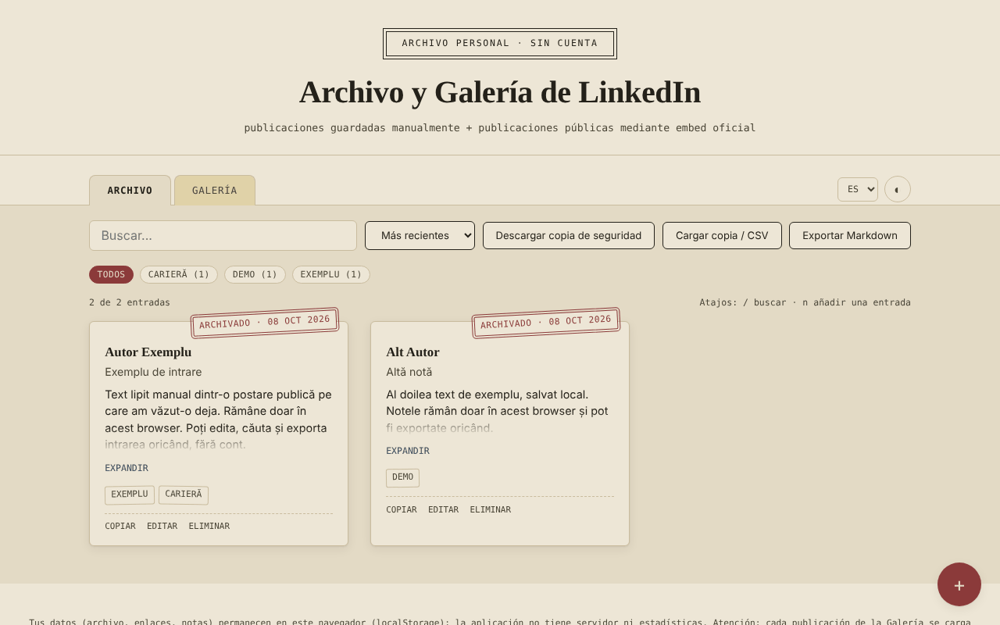

# Archivo y Galería de LinkedIn — momentos guardados, sin cuenta

[English](README.md) · [Română](README.ro.md) · [Français](README.fr.md) · [Italiano](README.it.md) · **Español** · [Português](README.pt.md) · [Deutsch](README.de.md) · [Magyar](README.hu.md)

**Versión:** 1.2.5 · **Última actualización:** 2026-10-23

Idiomas de la interfaz: **Română, English, Français, Italiano, Español, Português (PT), Deutsch, Magyar**

Un único archivo HTML en el que guardas localmente notas sobre publicaciones de LinkedIn (copiadas manualmente) y una galería de publicaciones públicas mostradas mediante el embed oficial de LinkedIn.

**Aplicación en línea:** https://chiuta.github.io/Arhiva-LinkedIn/

*(La captura contiene entradas de ejemplo introducidas para la demostración.)*

## Qué es

Dos pestañas: **Archivo** (texto, autor, enlace, etiquetas, pegados por ti desde publicaciones que ya has visto) y **Galería** (el enlace de una publicación pública de LinkedIn o el código «Embed this post», mostrado en un iframe oficial de LinkedIn). La aplicación no se conecta a LinkedIn, no extrae contenido (scraping) y no utiliza la API de LinkedIn: todo lo que aparece en el Archivo es lo que has pegado tú, y la Galería solo carga el embed que LinkedIn ofrece públicamente. No oficial, sin afiliación con LinkedIn.

## Funciones

Verificadas en el código:
- Añadir / editar / eliminar (con confirmación) entradas, en ambas pestañas; etiquetas, filtrado por etiqueta, búsqueda (sin distinguir diacríticos ni mayúsculas), ordenación por fecha.
- Galería: acepta el código iframe «Embed this post», un URN `urn:li:activity|share:…` o un enlace de publicación que contenga `-activity-<número>-`; construye la dirección `https://www.linkedin.com/embed/feed/update/...`; las direcciones de otros dominios se rechazan.
- Contador «N de M entradas», número de entradas por etiqueta, ordenación también por autor (A–Z).
- Exportación a Markdown de la lista filtrada de la pestaña activa; botón «Copiar» en las entradas del Archivo (texto, título, enlace).
- Aviso al guardar un enlace que ya existe (se puede guardar igualmente al pulsar por segunda vez).
- Atajos de teclado: `/` para buscar, `n` para una entrada nueva (cuando el foco no está en un campo de texto).
- Estilo de impresión: solo se imprimen las tarjetas del Archivo, sin la barra de herramientas.
- Importación CSV en el Archivo (botón «Cargar copia / CSV»): la columna de texto es obligatoria (`content`, `text`, `commentary` o `ShareCommentary`); opcionales `url`/`link`/`ShareLink`, `author`, `title`, `date`, `tags`; separador `,` o `;`, campos entre comillas; los duplicados (mismo enlace y mismo texto) y las filas sin texto se omiten, y los enlaces que no sean http(s) se ignoran. Útil para traer de golpe notas de una tabla propia o de una exportación CSV.
- Copia de seguridad JSON (descarga/carga); al importar, las entradas se validan y las que tienen un `id` ya existente se ignoran.
- Tema claro/oscuro, 8 idiomas (RO, EN, FR, IT, ES, PT, DE, HU).

## Guía de uso

1. En **Archivo** pulsa «+», pega el texto de la publicación (obligatorio), opcionalmente el enlace, el autor, el título, la fecha y las etiquetas, y luego «Guardar».
2. En **Galería** pulsa «+» y pega el enlace de la publicación pública o el código de «Embed this post» (en LinkedIn: el botón «…» → «Embed this post»).
3. Usa la búsqueda, las etiquetas y la ordenación para encontrar entradas.
4. «Descargar copia» guarda todo en un archivo JSON; «Cargar copia» lo recupera en otro navegador.

## Privacidad y red

- Almacenamiento: `localStorage` (claves `lka_archive_v1`, `lka_gallery_v1`, `lka_theme_v1`, `lka_lang_v1`). Los datos permanecen en tu navegador; no hay servidor propio ni estadísticas. Si el almacenamiento está bloqueado (modo privado), la aplicación muestra un mensaje al guardar.
- Host externo: `www.linkedin.com`, **solo** en la pestaña Galería, una solicitud por cada publicación mostrada. «Sin cuenta» no significa «sin rastreo»: LinkedIn recibe tu dirección IP y la dirección de la publicación mostrada, puede establecer sus propias cookies dentro de ese marco y, si has iniciado sesión en LinkedIn en el mismo navegador, puede reconocerte. Si no lo quieres, usa solo la pestaña Archivo.
- Los enlaces «Abrir el original» se abren solo al hacer clic, con `noopener`; solo se aceptan enlaces `http(s)`.
- Permisos del navegador: no solicita ninguno.

## Límites y advertencias

- Las publicaciones del Archivo pueden contener textos y datos personales de otras personas y están protegidas por derechos de autor; consérvalas para uso personal y respeta los Términos de LinkedIn y la legislación sobre datos personales antes de volver a publicarlas.
- La Galería solo muestra lo que LinkedIn permite incrustar; las publicaciones eliminadas o privadas no se muestran.
- La vista previa de los embeds no pudo probarse con una red real en este repositorio; las pruebas usaron un sustituto local del marco de LinkedIn.
- El sandbox del marco (`allow-scripts allow-same-origin allow-popups…`) es una medida de precaución; si un embed no se muestra correctamente, es lo primero que hay que comprobar.

## Ejecución local / sin conexión

Descarga `index.html` y ábrelo en un navegador. La pestaña Archivo funciona por completo sin conexión; la Galería necesita internet.

## Historial / Changelog

### 1.2.3 — 2026-10-22
- fff-kit 1.1.4: objetivos táctiles y tamaño mínimo de texto

### 1.2.2 — 2026-10-22
- fff-kit 1.1.2: PBKDF2 600 000 iteraciones, protección anti-clickjacking

### 1.2.1 — 2026-10-22
- Los embeds de la Galería se cargan ahora solo al hacer clic: abrir la aplicación o la pestaña Galería ya no contacta con LinkedIn; cada publicación se carga solo al pulsar «Cargar la publicación» (con una nota de que LinkedIn ve entonces tu IP).
- Móvil: ningún texto por debajo de 12 px y áreas táctiles de al menos 24 px (WCAG 2.5.8).

### 1.1.0 — 2026-10-14
- Copia de seguridad y etiquetado de datos (fff-kit).

### 12 de octubre de 2026 (v1.0.0)
- 1.0.0 — 2026-10-12: la versión y la fecha de la última actualización se muestran en la aplicación

### 11 de octubre de 2026 (tercera entrada)
- Importación CSV en el Archivo, con detección del separador y de las columnas a partir del encabezado, omisión de duplicados y mensajes en los 7 idiomas; el mensaje de error de importación ahora menciona también el formato CSV.

### 11 de octubre de 2026 (segunda entrada)
- Política CSP: `script-src` con hash en lugar de `'unsafe-inline'` (la aplicación no tenía atributos `on*` en línea).
- Funciones nuevas: exportación a Markdown, copia de entrada, contador y recuentos por etiqueta, ordenación por autor, aviso de enlaces duplicados, atajos de teclado, estilo de impresión; los textos nuevos están traducidos a los 7 idiomas.
- Captura de pantalla actualizada (el botón «Exportar Markdown», el contador y la acción «Copiar»).

### 11 de octubre de 2026
- Accesibilidad: el contenido principal está envuelto en <main> (axe: 0 infracciones).
- Al guardar una entrada vacía, el mensaje de error se muestra ahora como alerta anunciada por los lectores de pantalla y el foco pasa al campo «Contenido».

## Licencia

MIT — véase el archivo [LICENSE](LICENSE).

## Autor

Alexio — Alexandru-Ionuț Chiuță, contacto: alexio@trom.tf

## Resumen

Un cuaderno no oficial de un único archivo para publicaciones de LinkedIn: una pestaña Archivo para el texto que pegas manualmente y una pestaña Galería que muestra publicaciones públicas mediante el iframe de incrustación oficial de LinkedIn. No extrae datos de LinkedIn ni usa su API. Los datos se guardan en localStorage; la Galería contacta con www.linkedin.com (que ve tu IP y la dirección de la publicación). Interfaz en 8 idiomas, copia de seguridad JSON, exportación a Markdown, copia de entradas, aviso de enlace duplicado, atajos de teclado (/ y n), hoja de estilo de impresión. Licencia: MIT (véase LICENSE).
