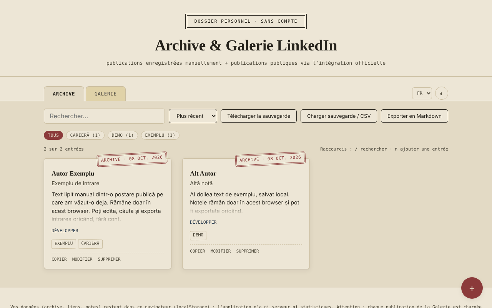

# Archive & Galerie LinkedIn — moments enregistrés, sans compte

[English](README.md) · [Română](README.ro.md) · **Français** · [Italiano](README.it.md) · [Español](README.es.md) · [Português](README.pt.md) · [Deutsch](README.de.md) · [Magyar](README.hu.md)

**Version :** 1.2.2 · **Dernière mise à jour :** 2026-10-22

Langues de l'interface : **Română, English, Français, Italiano, Español, Português (PT), Deutsch, Magyar**

Un seul fichier HTML dans lequel vous conservez localement des notes sur des publications LinkedIn (copiées manuellement) et une galerie de publications publiques affichées via l'embed officiel de LinkedIn.

**Application en ligne :** https://chiuta.github.io/Arhiva-LinkedIn/

*(La capture contient des entrées d'exemple ajoutées pour la démonstration.)*

## De quoi s'agit-il

Deux onglets : **Archive** (texte, auteur, lien, étiquettes, collés par vous à partir de publications que vous avez déjà vues) et **Galerie** (le lien d'une publication LinkedIn publique ou le code « Embed this post », affiché dans un iframe officiel de LinkedIn). L'application ne se connecte pas à LinkedIn, n'extrait pas de contenu (scraping) et n'utilise pas l'API de LinkedIn : tout ce qui apparaît dans l'Archive est ce que vous avez collé, et la Galerie se contente de charger l'embed que LinkedIn propose publiquement. Non officielle, sans affiliation avec LinkedIn.

## Fonctionnalités

Vérifiées dans le code :
- Ajout / modification / suppression (avec confirmation) d'entrées, dans les deux onglets ; étiquettes, filtrage par étiquette, recherche (insensible aux diacritiques et à la casse), tri par date.
- Galerie : accepte le code iframe « Embed this post », un URN `urn:li:activity|share:…` ou un lien de publication contenant `-activity-<numéro>-` ; construit l'adresse `https://www.linkedin.com/embed/feed/update/...` ; les adresses d'autres domaines sont rejetées.
- Compteur « N sur M entrées », nombre d'entrées par étiquette, tri aussi par auteur (A–Z).
- Export Markdown de la liste filtrée de l'onglet actif ; bouton « Copier » sur les entrées de l'Archive (texte, titre, lien).
- Avertissement lors de l'enregistrement d'un lien déjà existant (on peut l'enregistrer quand même au second appui).
- Raccourcis clavier : `/` pour la recherche, `n` pour une nouvelle entrée (lorsque le focus n'est pas dans un champ de texte).
- Style d'impression : seules les cartes de l'Archive sont imprimées, sans barre d'outils.
- Import CSV dans l'Archive (bouton « Charger une sauvegarde / CSV ») : la colonne de texte est obligatoire (`content`, `text`, `commentary` ou `ShareCommentary`) ; facultatifs `url`/`link`/`ShareLink`, `author`, `title`, `date`, `tags` ; séparateur `,` ou `;`, champs entre guillemets ; les doublons (même lien et même texte) et les lignes sans texte sont ignorés, et les liens non http(s) sont écartés. Utile pour reprendre en bloc des notes d'un tableau personnel ou d'un export CSV.
- Sauvegarde JSON (téléchargement/chargement) ; à l'import, les entrées sont validées et celles dont l'`id` existe déjà sont ignorées.
- Thème clair/sombre, 8 langues (RO, EN, FR, IT, ES, PT, DE, HU).

## Mode d'emploi

1. Dans **Archive**, appuyez sur « + », collez le texte de la publication (obligatoire), éventuellement le lien, l'auteur, le titre, la date et les étiquettes, puis « Enregistrer ».
2. Dans **Galerie**, appuyez sur « + » et collez le lien de la publication publique ou le code de « Embed this post » (sur LinkedIn : le bouton « … » → « Embed this post »).
3. Utilisez la recherche, les étiquettes et le tri pour retrouver des entrées.
4. « Télécharger la sauvegarde » enregistre tout dans un fichier JSON ; « Charger une sauvegarde » la reprend dans un autre navigateur.

## Confidentialité et réseau

- Stockage : `localStorage` (clés `lka_archive_v1`, `lka_gallery_v1`, `lka_theme_v1`, `lka_lang_v1`). Les données restent dans votre navigateur ; il n'y a pas de serveur propre ni de statistiques. Si le stockage est bloqué (mode privé), l'application affiche un message lors de l'enregistrement.
- Hôte externe : `www.linkedin.com`, **uniquement** dans l'onglet Galerie, une requête par publication affichée. « Sans compte » ne signifie pas « sans suivi » : LinkedIn reçoit votre adresse IP et l'adresse de la publication affichée, peut déposer ses propres cookies dans ce cadre et, si vous êtes connecté à LinkedIn dans le même navigateur, peut vous reconnaître. Si vous ne le souhaitez pas, utilisez uniquement l'onglet Archive.
- Les liens « Ouvrir l'original » s'ouvrent uniquement au clic, avec `noopener` ; seuls les liens `http(s)` sont acceptés.
- Autorisations du navigateur : aucune n'est demandée.

## Limites et avertissements

- Les publications de l'Archive peuvent contenir des textes et des données personnelles d'autres personnes et sont protégées par le droit d'auteur ; conservez-les pour un usage personnel et respectez les conditions d'utilisation de LinkedIn et la législation sur les données personnelles avant de les republier.
- La Galerie n'affiche que ce que LinkedIn permet d'intégrer ; les publications supprimées ou privées ne s'affichent pas.
- L'aperçu des embeds n'a pas pu être testé avec un vrai réseau dans ce dépôt ; les tests ont utilisé un substitut local du cadre LinkedIn.
- Le sandbox du cadre (`allow-scripts allow-same-origin allow-popups…`) est une mesure de précaution ; si un embed ne s'affiche pas correctement, c'est la première chose à vérifier.

## Exécution locale / hors ligne

Téléchargez `index.html` et ouvrez-le dans un navigateur. L'onglet Archive fonctionne entièrement hors ligne ; la Galerie a besoin d'Internet.

## Historique / Changelog

### 1.2.2 — 2026-10-22
- fff-kit 1.1.2 : PBKDF2 600 000 itérations, protection anti-clickjacking

### 1.2.1 — 2026-10-22
- Les embeds de la Galerie se chargent désormais au clic : ouvrir l'application ou l'onglet Galerie ne contacte plus LinkedIn ; chaque publication ne se charge qu'après « Charger la publication » (avec une note indiquant que LinkedIn voit alors votre IP).
- Mobile : aucun texte sous 12 px et cibles tactiles d'au moins 24 px (WCAG 2.5.8).

### 1.1.0 — 2026-10-14
- Sauvegarde et étiquetage des données (fff-kit).

### 12 octobre 2026 (v1.0.0)
- 1.0.0 — 2026-10-12 : la version et la date de la dernière mise à jour sont affichées dans l'application

### 11 octobre 2026 (troisième entrée)
- Import CSV dans l'Archive, avec détection du séparateur et des colonnes d'après l'en-tête, omission des doublons et messages dans les 7 langues ; le message d'erreur d'import mentionne désormais aussi le format CSV.

### 11 octobre 2026 (deuxième entrée)
- Politique CSP : `script-src` avec un hachage au lieu de `'unsafe-inline'` (l'application n'avait pas d'attributs `on*` en ligne).
- Nouvelles fonctionnalités : export Markdown, copie d'une entrée, compteur et décomptes par étiquette, tri par auteur, avertissement pour les liens en double, raccourcis clavier, style d'impression ; les nouveaux textes sont traduits dans les 7 langues.
- Capture d'écran mise à jour (le bouton « Exporter en Markdown », le compteur et l'action « Copier »).

### 11 octobre 2026
- Accessibilité : le contenu principal est encadré par <main> (axe : 0 violation).
- L'enregistrement d'une entrée vide affiche désormais le message d'erreur sous forme d'alerte annoncée par les lecteurs d'écran et place le focus dans le champ « Contenu ».

## Licence

MIT — voir le fichier [LICENSE](LICENSE).

## Auteur

Alexio — Alexandru-Ionuț Chiuță, contact : alexio@trom.tf

## Résumé

Un carnet non officiel, en un seul fichier, pour les publications LinkedIn : un onglet Archive pour le texte que vous collez manuellement, et un onglet Galerie qui affiche les publications publiques via l'iframe d'intégration officielle de LinkedIn. Il n'extrait pas de données de LinkedIn et n'utilise pas son API. Les données sont conservées dans localStorage ; la Galerie contacte www.linkedin.com (qui voit votre IP et l'adresse de la publication). Interface en 8 langues, sauvegarde JSON, export Markdown, copie d'une entrée, avertissement en cas de lien en double, raccourcis clavier (/ et n), feuille de style d'impression. Licence : MIT (voir LICENSE).

