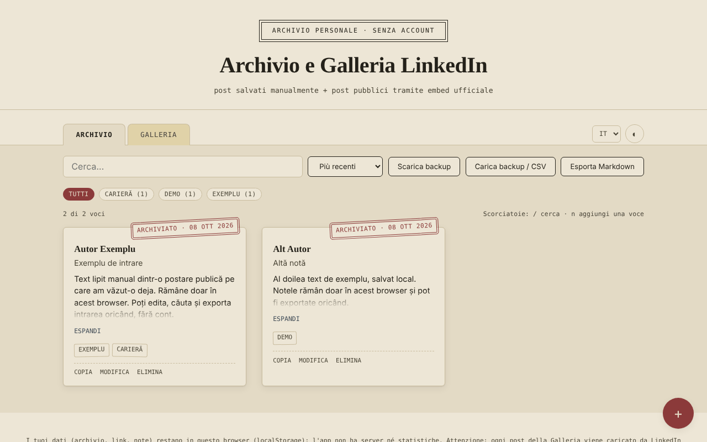

# Archivio & Galleria LinkedIn — momenti salvati, senza account

[English](README.md) · [Română](README.ro.md) · [Français](README.fr.md) · **Italiano** · [Español](README.es.md) · [Português](README.pt.md) · [Deutsch](README.de.md) · [Magyar](README.hu.md)

**Versione:** 2.1.0 · **Ultimo aggiornamento:** 2026-10-27

Lingue dell'interfaccia: **Română, English, Français, Italiano, Español, Português (PT), Deutsch, Magyar**

Un unico file HTML in cui conservi localmente note sui post di LinkedIn (copiate manualmente) e una galleria di post pubblici mostrati tramite l'embed ufficiale di LinkedIn.

**App online:** https://chiuta.github.io/Arhiva-LinkedIn/

*(La schermata contiene voci di esempio inserite a scopo dimostrativo.)*

## Cos'è

Due schede: **Archivio** (testo, autore, link, tag, incollati da te da post che hai già visto) e **Galleria** (il link di un post pubblico di LinkedIn o il codice «Embed this post», mostrato in un iframe ufficiale di LinkedIn). L'app non si collega a LinkedIn, non estrae contenuti (scraping) e non usa l'API di LinkedIn: tutto ciò che appare nell'Archivio è ciò che hai incollato tu, e la Galleria si limita a caricare l'embed che LinkedIn offre pubblicamente. Non ufficiale, non affiliata a LinkedIn.

## Funzioni

Verificate nel codice:
- Aggiunta / modifica / eliminazione (con conferma) di voci, in entrambe le schede; tag, filtro per tag, ricerca (senza distinzione di diacritici e maiuscole), ordinamento per data.
- Galleria: accetta il codice iframe «Embed this post», un URN `urn:li:activity|share:…` o un link a un post contenente `-activity-<numero>-`; costruisce l'indirizzo `https://www.linkedin.com/embed/feed/update/...`; gli indirizzi di altri domini vengono rifiutati.
- Contatore «N di M voci», numero di voci per ogni tag, ordinamento anche per autore (A–Z).
- Esportazione Markdown dell'elenco filtrato della scheda attiva; pulsante «Copia» sulle voci dell'Archivio (testo, titolo, link).
- Avviso al salvataggio di un link già esistente (si può salvare comunque alla seconda pressione).
- Scorciatoie da tastiera: `/` per la ricerca, `n` per una nuova voce (quando il focus non è in un campo di testo).
- Stile di stampa: vengono stampate solo le schede dell'Archivio, senza barra degli strumenti.
- Importazione CSV nell'Archivio (pulsante «Carica backup / CSV»): la colonna di testo è obbligatoria (`content`, `text`, `commentary` o `ShareCommentary`); facoltativi `url`/`link`/`ShareLink`, `author`, `title`, `date`, `tags`; separatore `,` o `;`, campi tra virgolette; i duplicati (stesso link e stesso testo) e le righe senza testo vengono omessi, e i link non http(s) vengono ignorati. Utile per importare in blocco note da una tabella propria o da un'esportazione CSV.
- Backup JSON (download/caricamento); all'importazione le voci vengono convalidate e quelle con `id` già esistente vengono ignorate.
- Tema chiaro/scuro, 8 lingue (RO, EN, FR, IT, ES, PT, DE, HU).

## Guida all'uso

1. In **Archivio** premi «+», incolla il testo del post (obbligatorio), facoltativamente il link, l'autore, il titolo, la data e i tag, poi «Salva».
2. In **Galleria** premi «+» e incolla il link del post pubblico o il codice di «Embed this post» (su LinkedIn: il pulsante «…» → «Embed this post»).
3. Usa la ricerca, i tag e l'ordinamento per trovare le voci.
4. «Scarica backup» salva tutto in un file JSON; «Carica backup» lo ripristina in un altro browser.

## Privacy e rete

- Archiviazione: `localStorage` (chiavi `lka_archive_v1`, `lka_gallery_v1`, `lka_theme_v1`, `lka_lang_v1`). I dati restano nel tuo browser; non esiste un server proprio e non ci sono statistiche. Se l'archiviazione è bloccata (modalità privata), l'app mostra un messaggio al momento del salvataggio.
- Host esterno: `www.linkedin.com`, **solo** nella scheda Galleria, una richiesta per ogni post mostrato. «Senza account» non significa «senza tracciamento»: LinkedIn riceve il tuo indirizzo IP e l'indirizzo del post mostrato, può impostare propri cookie all'interno di quel frame e, se sei autenticato su LinkedIn nello stesso browser, può riconoscerti. Se non lo desideri, usa solo la scheda Archivio.
- I link «Apri l'originale» si aprono solo al clic, con `noopener`; sono accettati solo link `http(s)`.
- Permessi del browser: non ne richiede nessuno.

## Limiti e avvertenze

- I post dell'Archivio possono contenere testi e dati personali di altre persone e sono protetti dal diritto d'autore; conservali per uso personale e rispetta i Termini di LinkedIn e la normativa sui dati personali prima di ripubblicarli.
- La Galleria mostra solo ciò che LinkedIn consente di incorporare; i post eliminati o privati non vengono mostrati.
- L'anteprima degli embed non ha potuto essere testata con una rete reale in questo repository; i test hanno usato un sostituto locale del frame di LinkedIn.
- La sandbox del frame (`allow-scripts allow-same-origin allow-popups…`) è una misura precauzionale; se un embed non viene mostrato correttamente, questo è il primo controllo da fare.

## Esecuzione locale / offline

Scarica `index.html` e aprilo in un browser. La scheda Archivio funziona completamente offline; la Galleria richiede Internet.

## Cronologia / Changelog

### 1.2.3 — 2026-10-22
- fff-kit 1.1.4: target touch e dimensione minima del testo

### 1.2.2 — 2026-10-22
- fff-kit 1.1.2: PBKDF2 600.000 iterazioni, protezione anti-clickjacking

### 1.2.1 — 2026-10-22
- Gli embed della Galleria si caricano ora solo al clic: aprire l'app o la scheda Galleria non contatta più LinkedIn; ogni post si carica solo premendo «Carica il post» (con una nota che LinkedIn vede poi il tuo IP).
- Mobile: nessun testo sotto i 12 px e aree tattili di almeno 24 px (WCAG 2.5.8).

### 1.1.0 — 2026-10-14
- Backup e etichettatura dei dati (fff-kit).

### 12 ottobre 2026 (v1.0.0)
- 1.0.0 — 2026-10-12: la versione e la data dell'ultimo aggiornamento sono mostrate nell'app

### 11 ottobre 2026 (terza voce)
- Importazione CSV nell'Archivio, con rilevamento del separatore e delle colonne dall'intestazione, omissione dei duplicati e messaggi nelle 7 lingue; il messaggio di errore di importazione ora menziona anche il formato CSV.

### 11 ottobre 2026 (seconda voce)
- Policy CSP: `script-src` con hash al posto di `'unsafe-inline'` (l'app non aveva attributi `on*` inline).
- Nuove funzioni: esportazione Markdown, copia della voce, contatore e conteggi per tag, ordinamento per autore, avviso per link duplicati, scorciatoie da tastiera, stile di stampa; i nuovi testi sono tradotti in tutte e 7 le lingue.
- Schermata aggiornata (il pulsante «Esporta Markdown», il contatore e l'azione «Copia»).

### 11 ottobre 2026
- Accessibilità: il contenuto principale è racchiuso in <main> (axe: 0 violazioni).
- Il salvataggio di una voce vuota ora mostra il messaggio di errore come avviso annunciato dagli screen reader e sposta il focus sul campo «Contenuto».

## Licenza

MIT — vedi il file [LICENSE](LICENSE).

## Autore

Alexio — Alexandru-Ionuț Chiuță, contatto: alexio@trom.tf

## Riepilogo

Un taccuino non ufficiale, in un unico file, per i post di LinkedIn: una scheda Archivio per il testo incollato a mano e una scheda Galleria che mostra post pubblici tramite l'iframe di incorporamento ufficiale di LinkedIn. Non fa scraping di LinkedIn né usa la sua API. I dati sono conservati in localStorage; la Galleria contatta www.linkedin.com (che vede il tuo IP e l'indirizzo del post). 8 lingue dell'interfaccia, backup JSON, esportazione Markdown, copia della voce, avviso di link duplicato, scorciatoie da tastiera (/ e n), foglio di stile per la stampa. Licenza: MIT (vedi LICENSE).
