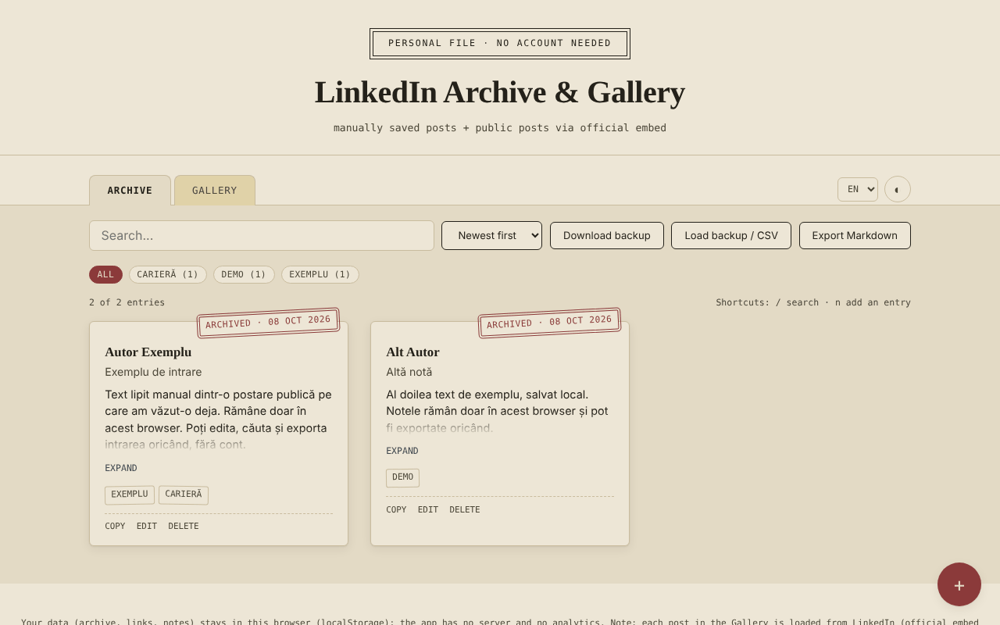

# LinkedIn Archive & Gallery — saved moments, no account

**English** · [Română](README.ro.md) · [Français](README.fr.md) · [Italiano](README.it.md) · [Español](README.es.md) · [Português](README.pt.md) · [Deutsch](README.de.md) · [Magyar](README.hu.md)

**Version:** 1.2.5 · **Last updated:** 2026-10-23

Interface languages: **Română, English, Français, Italiano, Español, Português (PT), Deutsch, Magyar**

A single HTML file in which you keep local notes about LinkedIn posts (copied manually) and a gallery of public posts displayed through LinkedIn's official embed.

**Live app:** https://chiuta.github.io/Arhiva-LinkedIn/

*(The screenshot contains sample entries added for demonstration.)*

## What it is

Two tabs: **Archive** (text, author, link, tags, pasted by you from posts you have already seen) and **Gallery** (the link of a public LinkedIn post or the "Embed this post" code, displayed in an official LinkedIn iframe). The app does not connect to LinkedIn, does not scrape content and does not use the LinkedIn API: everything that appears in the Archive is what you pasted, and the Gallery only loads the embed that LinkedIn offers publicly. Unofficial, not affiliated with LinkedIn.

## Features

Verified in the code:
- Add / edit / delete (with confirmation) entries, in both tabs; tags, filtering by tag, search (diacritic- and case-insensitive), sorting by date.
- Gallery: accepts the "Embed this post" iframe code, a `urn:li:activity|share:…` URN or a post link containing `-activity-<number>-`; builds the `https://www.linkedin.com/embed/feed/update/...` address; addresses from other domains are rejected.
- "N of M entries" counter, number of entries per tag, sorting also by author (A–Z).
- Markdown export of the filtered list in the active tab; "Copy" button on Archive entries (text, title, link).
- Warning when saving a link that already exists (it can still be saved on the second press).
- Keyboard shortcuts: `/` for search, `n` for a new entry (when focus is not in a text field).
- Print style: only the Archive cards are printed, without the toolbar.
- CSV import into the Archive ("Load backup / CSV" button): the text column is mandatory (`content`, `text`, `commentary` or `ShareCommentary`); optional `url`/`link`/`ShareLink`, `author`, `title`, `date`, `tags`; `,` or `;` separator, quoted fields; duplicates (same link and text) and rows without text are skipped, and non-http(s) links are ignored. Useful for bulk-importing notes from your own spreadsheet or from a CSV export.
- JSON backup (download/upload); on import, entries are validated and those with an already existing `id` are ignored.
- Light/dark theme, 8 languages (RO, EN, FR, IT, ES, PT, DE, HU).

## User guide

1. In **Archive**, press "+", paste the post text (mandatory), optionally the link, author, title, date and tags, then "Save".
2. In **Gallery**, press "+" and paste the link of the public post or the code from "Embed this post" (on LinkedIn: the "…" button → "Embed this post").
3. Use search, tags and sorting to find entries.
4. "Download backup" saves everything in a JSON file; "Load backup" restores it in another browser.

## Privacy and network

- Storage: `localStorage` (keys `lka_archive_v1`, `lka_gallery_v1`, `lka_theme_v1`, `lka_lang_v1`). Data stays in your browser; there is no server of our own and no statistics. If storage is blocked (private mode), the app shows a message on save.
- External host: `www.linkedin.com`, **only** in the Gallery tab, one request for each post displayed. "No account" does not mean "no tracking": LinkedIn receives your IP address and the address of the displayed post, may set its own cookies within that frame and, if you are signed in to LinkedIn in the same browser, may recognise you. If you do not want this, use only the Archive tab.
- "Open original" links open only on click, with `noopener`; only `http(s)` links are accepted.
- Browser permissions: it requests none.

## Limits and warnings

- Posts in the Archive may contain other people's personal texts and data and are protected by copyright; keep them for personal use and respect LinkedIn's Terms and personal data legislation before republishing them.
- The Gallery shows only what LinkedIn allows to be embedded; deleted or private posts are not displayed.
- The embed preview could not be tested with a real network in this repository; the tests used a local stand-in for the LinkedIn frame.
- The frame's sandbox (`allow-scripts allow-same-origin allow-popups…`) is a precaution; if an embed does not display correctly, this is the first thing to check.

## Local / offline use

Download `index.html` and open it in a browser. The Archive tab works fully offline; the Gallery needs internet.

## History / Changelog

### 1.2.5 — 2026-10-23
- Fix: when `localStorage` is full or blocked, saving/importing/deleting no longer ends with a misleading "success" message (the storage-error message is now the one that stays)
- Fix: a JSON file with neither `archive` nor `gallery` is rejected instead of reporting "import successful +0"
- Hardening: gallery embed addresses keep only the `?collapsed=<digit>` parameter
- Hardening: a saved language such as `constructor` (inherited object key) is no longer accepted, so `<html lang>` never gets an invalid value
- Touch targets: 24 px minimum, 44 px on touch screens; `app.json` now lists the `localStorage` keys

### 1.2.3 — 2026-10-22
- fff-kit 1.1.4: touch targets and minimum text size

### 1.2.2 — 2026-10-22
- fff-kit 1.1.2: PBKDF2 600,000 iterations, anti-clickjacking protection

### 1.2.1 — 2026-10-22
- Gallery embeds are now click-to-load: opening the app or the Gallery tab no longer contacts LinkedIn; each post loads only when you press "Load post" (with a note that LinkedIn then sees your IP).
- Mobile: no text below 12 px and touch targets of at least 24 px (WCAG 2.5.8).

### 1.1.0 — 2026-10-14
- Data backup and labelling (fff-kit).

### 12 October 2026 (v1.0.0)
- 1.0.0 — 2026-10-12: the version and the date of the last update are shown in the app

### 11 October 2026 (third entry)
- CSV import into the Archive, with separator and column detection from the header, skipping of duplicates and messages in the 7 languages; the import error message now also mentions the CSV format.

### 11 October 2026 (second entry)
- CSP policy: `script-src` with a hash instead of `'unsafe-inline'` (the app had no inline `on*` attributes).
- New features: Markdown export, entry copy, counter and per-tag counts, sorting by author, warning for duplicate links, keyboard shortcuts, print style; the new texts are translated into all 7 languages.
- Screenshot updated (the "Export Markdown" button, the counter and the "Copy" action).

### 11 October 2026
- Accessibility: the main content is wrapped in <main> (axe: 0 violations).
- Saving an empty entry now shows the error message as an alert announced by screen readers and moves focus to the "Content" field.

## Licence

MIT — see the [LICENSE](LICENSE) file.

## Author

Alexio — Alexandru-Ionuț Chiuță, contact: alexio@trom.tf

## English summary

A single-file, unofficial notebook for LinkedIn posts: an Archive tab for text you paste manually, and a Gallery tab that shows public posts through LinkedIn's official embed iframe. It does not scrape LinkedIn or use its API. Data is kept in localStorage; the Gallery contacts www.linkedin.com (which sees your IP and the post address). 8 UI languages, JSON backup, Markdown export, copy-entry, duplicate-link warning, keyboard shortcuts (/ and n), print stylesheet. License: MIT (see LICENSE).
