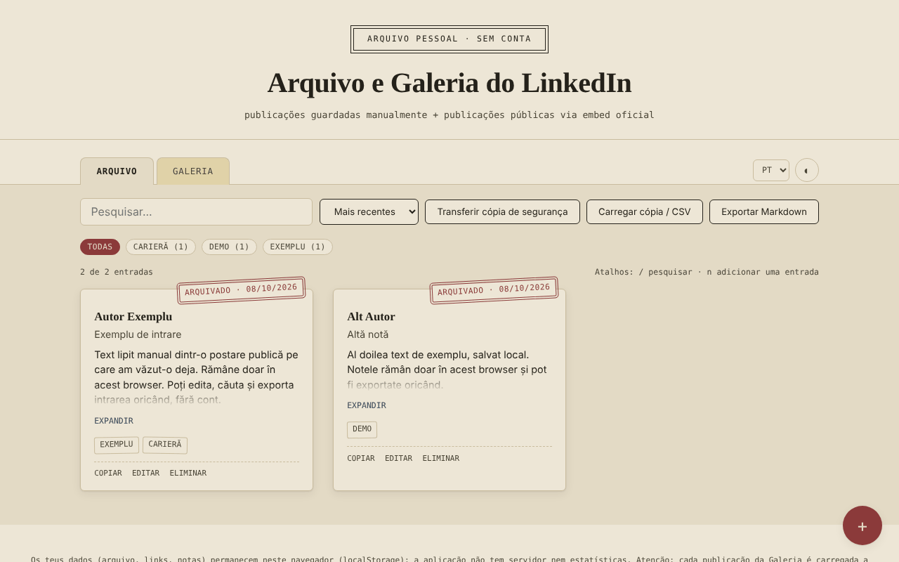

# Arquivo e Galeria do LinkedIn — momentos guardados, sem conta

[English](README.md) · [Română](README.ro.md) · [Français](README.fr.md) · [Italiano](README.it.md) · [Español](README.es.md) · **Português** · [Deutsch](README.de.md) · [Magyar](README.hu.md)

**Versão:** 1.2.5 · **Última atualização:** 2026-10-26

Idiomas da interface: **Română, English, Français, Italiano, Español, Português (PT), Deutsch, Magyar**

Um único ficheiro HTML onde guardas localmente notas sobre publicações do LinkedIn (copiadas manualmente) e uma galeria de publicações públicas apresentadas através do embed oficial do LinkedIn.

**Aplicação online:** https://chiuta.github.io/Arhiva-LinkedIn/

*(A captura contém entradas de exemplo introduzidas para demonstração.)*

## O que é

Dois separadores: **Arquivo** (texto, autor, ligação, etiquetas, colados por ti a partir de publicações que já viste) e **Galeria** (a ligação de uma publicação pública do LinkedIn ou o código «Embed this post», apresentado num iframe oficial do LinkedIn). A aplicação não se liga ao LinkedIn, não extrai conteúdo (scraping) e não utiliza a API do LinkedIn: tudo o que aparece no Arquivo é o que colaste, e a Galeria apenas carrega o embed que o LinkedIn oferece publicamente. Não oficial, sem afiliação ao LinkedIn.

## Funcionalidades

Verificadas no código:
- Adicionar / editar / eliminar (com confirmação) entradas, em ambos os separadores; etiquetas, filtragem por etiqueta, pesquisa (sem distinção de diacríticos e maiúsculas), ordenação por data.
- Galeria: aceita o código iframe «Embed this post», um URN `urn:li:activity|share:…` ou uma ligação de publicação que contenha `-activity-<número>-`; constrói o endereço `https://www.linkedin.com/embed/feed/update/...`; os endereços de outros domínios são rejeitados.
- Contador «N de M entradas», número de entradas por etiqueta, ordenação também por autor (A–Z).
- Exportação para Markdown da lista filtrada do separador ativo; botão «Copiar» nas entradas do Arquivo (texto, título, ligação).
- Aviso ao guardar uma ligação já existente (pode guardar-se na mesma ao premir pela segunda vez).
- Atalhos de teclado: `/` para pesquisar, `n` para uma nova entrada (quando o foco não está num campo de texto).
- Estilo de impressão: só se imprimem os cartões do Arquivo, sem a barra de ferramentas.
- Importação CSV no Arquivo (botão «Carregar cópia / CSV»): a coluna de texto é obrigatória (`content`, `text`, `commentary` ou `ShareCommentary`); opcionais `url`/`link`/`ShareLink`, `author`, `title`, `date`, `tags`; separador `,` ou `;`, campos entre aspas; os duplicados (mesma ligação e mesmo texto) e as linhas sem texto são omitidos, e as ligações que não sejam http(s) são ignoradas. Útil para trazer de uma só vez notas de uma tabela própria ou de uma exportação CSV.
- Cópia de segurança JSON (descarregar/carregar); na importação, as entradas são validadas e as que têm um `id` já existente são ignoradas.
- Tema claro/escuro, 8 línguas (RO, EN, FR, IT, ES, PT, DE, HU).

## Guia de utilização

1. No **Arquivo**, prime «+», cola o texto da publicação (obrigatório), opcionalmente a ligação, o autor, o título, a data e as etiquetas, e depois «Guardar».
2. Na **Galeria**, prime «+» e cola a ligação da publicação pública ou o código de «Embed this post» (no LinkedIn: o botão «…» → «Embed this post»).
3. Usa a pesquisa, as etiquetas e a ordenação para encontrar entradas.
4. «Descarregar cópia» guarda tudo num ficheiro JSON; «Carregar cópia» recupera-o noutro navegador.

## Privacidade e rede

- Armazenamento: `localStorage` (chaves `lka_archive_v1`, `lka_gallery_v1`, `lka_theme_v1`, `lka_lang_v1`). Os dados ficam no teu navegador; não existe servidor próprio nem estatísticas. Se o armazenamento estiver bloqueado (modo privado), a aplicação mostra uma mensagem ao guardar.
- Anfitrião externo: `www.linkedin.com`, **apenas** no separador Galeria, um pedido por cada publicação apresentada. «Sem conta» não significa «sem rastreamento»: o LinkedIn recebe o teu endereço IP e o endereço da publicação apresentada, pode definir cookies próprios dentro desse quadro e, se tiveres sessão iniciada no LinkedIn no mesmo navegador, pode reconhecer-te. Se não quiseres isso, usa apenas o separador Arquivo.
- As ligações «Abrir o original» só se abrem ao clicar, com `noopener`; só são aceites ligações `http(s)`.
- Permissões do navegador: não pede nenhuma.

## Limites e avisos

- As publicações do Arquivo podem conter textos e dados pessoais de outras pessoas e estão protegidas por direitos de autor; guarda-as para uso pessoal e respeita os Termos do LinkedIn e a legislação sobre dados pessoais antes de as voltares a publicar.
- A Galeria mostra apenas o que o LinkedIn permite incorporar; as publicações eliminadas ou privadas não são apresentadas.
- A pré-visualização dos embeds não pôde ser testada com uma rede real neste repositório; os testes usaram um substituto local do quadro do LinkedIn.
- A sandbox do quadro (`allow-scripts allow-same-origin allow-popups…`) é uma medida de precaução; se um embed não for apresentado corretamente, é a primeira coisa a verificar.

## Execução local / offline

Descarrega `index.html` e abre-o num navegador. O separador Arquivo funciona totalmente offline; a Galeria precisa de internet.

## Histórico / Changelog

### 1.2.3 — 2026-10-22
- fff-kit 1.1.4: alvos de toque e tamanho mínimo do texto

### 1.2.2 — 2026-10-22
- fff-kit 1.1.2: PBKDF2 600 000 iterações, proteção anti-clickjacking

### 1.2.1 — 2026-10-22
- Os embeds da Galeria carregam agora apenas ao clicar: abrir a aplicação ou o separador Galeria já não contacta o LinkedIn; cada publicação só carrega ao premir «Carregar a publicação» (com uma nota de que o LinkedIn passa a ver o seu IP).
- Telemóvel: nenhum texto abaixo de 12 px e áreas táteis de pelo menos 24 px (WCAG 2.5.8).

### 1.1.0 — 2026-10-14
- Cópia de segurança e etiquetagem de dados (fff-kit).

### 12 de outubro de 2026 (v1.0.0)
- 1.0.0 — 2026-10-12: a versão e a data da última atualização são apresentadas na aplicação

### 11 de outubro de 2026 (terceira entrada)
- Importação CSV no Arquivo, com deteção do separador e das colunas a partir do cabeçalho, omissão de duplicados e mensagens nas 7 línguas; a mensagem de erro de importação passa também a mencionar o formato CSV.

### 11 de outubro de 2026 (segunda entrada)
- Política CSP: `script-src` com hash em vez de `'unsafe-inline'` (a aplicação não tinha atributos `on*` inline).
- Novas funcionalidades: exportação para Markdown, cópia de entrada, contador e contagens por etiqueta, ordenação por autor, aviso de ligações duplicadas, atalhos de teclado, estilo de impressão; os textos novos estão traduzidos nas 7 línguas.
- Captura de ecrã atualizada (o botão «Exportar Markdown», o contador e a ação «Copiar»).

### 11 de outubro de 2026
- Acessibilidade: o conteúdo principal está envolvido em <main> (axe: 0 violações).
- Ao guardar uma entrada vazia, a mensagem de erro é agora apresentada como alerta anunciado pelos leitores de ecrã e o foco passa para o campo «Conteúdo».

## Licença

MIT — ver o ficheiro [LICENSE](LICENSE).

## Autor

Alexio — Alexandru-Ionuț Chiuță, contacto: alexio@trom.tf

## Resumo

Um caderno não oficial, num único ficheiro, para publicações do LinkedIn: um separador Arquivo para texto que cola manualmente e um separador Galeria que mostra publicações públicas através do iframe de incorporação oficial do LinkedIn. Não faz scraping do LinkedIn nem usa a sua API. Os dados são guardados em localStorage; a Galeria contacta www.linkedin.com (que vê o seu IP e o endereço da publicação). 8 idiomas de interface, cópia de segurança JSON, exportação Markdown, copiar entrada, aviso de ligação duplicada, atalhos de teclado (/ e n), folha de estilo de impressão. Licença: MIT (ver LICENSE).
