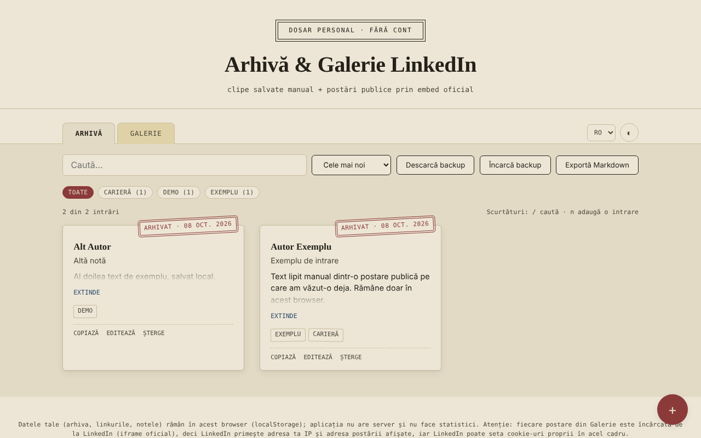

# Arhivă & Galerie LinkedIn — clipe salvate fără cont

[English](README.md) · **Română** · [Français](README.fr.md) · [Italiano](README.it.md) · [Español](README.es.md) · [Português](README.pt.md) · [Deutsch](README.de.md) · [Magyar](README.hu.md)

**Versiune:** 1.2.0 · **Ultima actualizare:** 2026-10-19

Limbile interfeței: **Română, English, Français, Italiano, Español, Português (PT), Deutsch, Magyar**

Un singur fișier HTML în care îți păstrezi local note despre postări LinkedIn (copiate manual) și o galerie de postări publice afișate prin embed-ul oficial LinkedIn.

**Live:** https://chiuta.github.io/Arhiva-LinkedIn/

*(Captura conține intrări de exemplu introduse pentru demonstrație.)*

## Ce este

Două file: **Arhivă** (text, autor, link, tag-uri, lipite de tine din postări pe care le-ai văzut deja) și **Galerie** (linkul unei postări publice LinkedIn sau codul „Embed this post", afișat într-un iframe oficial LinkedIn). Aplicația nu se conectează la LinkedIn, nu extrage (scrape) conținut și nu folosește API-ul LinkedIn: tot ce apare în Arhivă este ce ai lipit tu, iar Galeria doar încarcă embed-ul pe care LinkedIn îl oferă public. Neoficială, neafiliată cu LinkedIn.

## Funcții

Verificate în cod:
- Adăugare / editare / ștergere (cu confirmare) de intrări, în ambele file; tag-uri, filtrare după tag, căutare (fără diacritice și majuscule), sortare după dată.
- Galerie: acceptă codul iframe „Embed this post", un URN `urn:li:activity|share:…` sau un link de postare cu `-activity-<număr>-`; construiește adresa `https://www.linkedin.com/embed/feed/update/...`; adresele de alte domenii sunt respinse.
- Contor „N din M intrări”, număr de intrări pe fiecare tag, sortare și după autor (A–Z).
- Export Markdown al listei filtrate din fila activă; buton „Copiază” pe intrările din Arhivă (text, titlu, link).
- Avertisment la salvarea unui link deja existent (se poate salva oricum la a doua apăsare).
- Scurtături de tastatură: `/` pentru căutare, `n` pentru o intrare nouă (când focusul nu este într-un câmp de text).
- Stil de tipărire: se tipăresc doar cardurile Arhivei, fără bară de instrumente.
- Import CSV în Arhivă (butonul „Încarcă backup / CSV”): coloana de text este obligatorie (`content`, `text`, `commentary` sau `ShareCommentary`); opțional `url`/`link`/`ShareLink`, `author`, `title`, `date`, `tags`; separator `,` sau `;`, câmpuri între ghilimele; duplicatele (același link și text) și rândurile fără text sunt omise, iar linkurile non-http(s) sunt ignorate. Util pentru a prelua în bloc note dintr-un tabel propriu sau dintr-un export CSV.
- Backup JSON (descărcare/încărcare); la import intrările sunt validate și cele cu `id` deja existent sunt ignorate.
- Temă deschisă/întunecată, 8 limbi (RO, EN, FR, IT, ES, PT, DE, HU).

## Manual de utilizare

1. În **Arhivă** apasă „+", lipește textul postării (obligatoriu), opțional linkul, autorul, titlul, data și tag-urile, apoi „Salvează".
2. În **Galerie** apasă „+" și lipește linkul postării publice sau codul din „Embed this post" (pe LinkedIn: butonul „…" → „Embed this post").
3. Folosește căutarea, tag-urile și sortarea pentru a găsi intrări.
4. „Descarcă backup" salvează tot într-un fișier JSON; „Încarcă backup" îl reia pe alt browser.

## Confidențialitate și rețea

- Stocare: `localStorage` (chei `lka_archive_v1`, `lka_gallery_v1`, `lka_theme_v1`, `lka_lang_v1`). Datele rămân în browserul tău; nu există server propriu și nu există statistici. Dacă stocarea este blocată (mod privat), aplicația afișează un mesaj la salvare.
- Gazdă externă: `www.linkedin.com`, **doar** în fila Galerie, câte o cerere pentru fiecare postare afișată. „Fără cont" nu înseamnă „fără urmărire": LinkedIn primește adresa ta IP și adresa postării afișate, poate seta cookie-uri proprii în cadrul respectiv și, dacă ești autentificat pe LinkedIn în același browser, te poate recunoaște. Dacă nu vrei acest lucru, folosește doar fila Arhivă.
- Linkurile „Deschide originalul" se deschid doar la click, cu `noopener`; doar linkuri `http(s)` sunt acceptate.
- Permisiuni de browser: nu cere niciuna.

## Limite și avertismente

- Postările din Arhivă pot conține texte și date personale ale altor persoane și sunt protejate de drepturi de autor; păstrează-le pentru uz personal și respectă Termenii LinkedIn și legislația privind datele personale înainte de a le republica.
- Galeria arată doar ce permite LinkedIn să fie încorporat; postări șterse sau private nu se afișează.
- Previzualizarea embed-urilor nu a putut fi testată cu rețea reală în acest repository; testele au folosit un înlocuitor local pentru cadrul LinkedIn.
- Sandbox-ul cadrului (`allow-scripts allow-same-origin allow-popups…`) este o măsură de precauție; dacă un embed nu se afișează corect, aceasta este prima verificare.

## Rulare locală / offline

Descarcă `index.html` și deschide-l în browser. Fila Arhivă funcționează complet offline; Galeria are nevoie de internet.

## Istoric / Changelog

### 1.1.0 — 2026-10-14
- Copie de rezervă și etichetare date (fff-kit).

### 12 octombrie 2026 (v1.0.0)
- 1.0.0 — 2026-10-12: versiunea și data ultimei actualizări sunt afișate în aplicație

### 11 octombrie 2026 (a treia intrare)
- Import CSV în Arhivă, cu detectarea separatorului și a coloanelor după antet, omiterea duplicatelor și mesaje în cele 7 limbi; mesajul de eroare de import menționează acum și formatul CSV.

### 11 octombrie 2026 (a doua intrare)
- Politica CSP: `script-src` cu hash în loc de `'unsafe-inline'` (aplicația nu avea atribute `on*` inline).
- Funcții noi: export Markdown, copiere intrare, contor și numărători pe tag-uri, sortare după autor, avertisment pentru linkuri duplicate, scurtături de tastatură, stil de tipărire; textele noi sunt traduse în toate cele 7 limbi.
- Captura de ecran actualizată (butonul „Exportă Markdown”, contorul și acțiunea „Copiază”).

### 11 octombrie 2026
- Accesibilitate: conținutul principal este încadrat în <main> (axe: 0 violări).
- Salvarea unei intrări goale afișează acum mesajul de eroare ca alertă anunțată de cititoarele de ecran și mută focusul în câmpul „Conținut”.

## Licență

MIT — vezi fișierul [LICENSE](LICENSE).

## Autor

Alexio — Alexandru-Ionuț Chiuță, contact: alexio@trom.tf

## English summary

A single-file, unofficial notebook for LinkedIn posts: an Archive tab for text you paste manually, and a Gallery tab that shows public posts through LinkedIn's official embed iframe. It does not scrape LinkedIn or use its API. Data is kept in localStorage; the Gallery contacts www.linkedin.com (which sees your IP and the post address). 8 UI languages, JSON backup, Markdown export, copy-entry, duplicate-link warning, keyboard shortcuts (/ and n), print stylesheet. License: MIT (see LICENSE).
